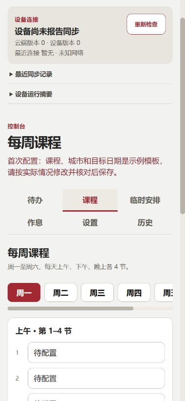

# J-Calendar Plus

**选定显示方案候选 `2.3.2-rc.6-dev.2`：** 首页保留现用三列并优化长天气间距；周课表恢复用户指定照片的粗体字、粗时间及加粗红框。未刷机，见 [交付记录](docs/weather-weekly-choice-20261017.md)。

**实屏反馈修正候选为 `2.3.2-rc.6-dev.1`。** 撤掉新增 20 px 字模，统一周课表文字与线宽，农历恢复辅助字号；详见 [修正与对照](docs/display-style-refine-20261017.md)。候选尚未刷入设备。

**此前的本地显示优化候选为 `2.3.2-rc.6-dev`。** 常用标题／课程使用原生 20 px，天气分行、负温与月历长倒计时限宽、干燥提醒留空已实现。构建与原生预览通过，尚未安装；详见 [本次交付](docs/display-style-20261017.md)。

**右下角倒计时新增五种模式，固件源码版本为 2.3.2-rc.5。** 在远程网页“显示设置”中选择节日、二十四节气或自定义日期；名称限 1–4 字。旧配置仍默认最近节日，主倒计时保持独立。需安装新固件后才能在实物上使用；此公开 rc.5 镜像尚未安装实机。使用规则见 [配置说明](remote/README.md#右下角倒计时2026-10-17)。

基于 [JADE-Jerry/jcalendar](https://github.com/JADE-Jerry/jcalendar) 的 4.2 寸黑白红墨水屏日历，显示课程、月历、倒计时、天气和待办，配套可自行部署的手机配置网页。

**当前公开预发布版：[v2.3.2-rc.5](https://github.com/xiongzai666/jcalendar-plus/releases/tag/v2.3.2-rc.5)。** 适用于经典 ESP32、4 MB Flash、400 × 300 三色屏。原作者和组件来源见 [NOTICE](NOTICE.md)，项目许可证见 [LICENSE](LICENSE)。

## 主要功能

- **四页显示**：课程与倒计时、日间周课表、月历、待办；按键切页，深睡眠时由上键唤醒。
- **课程与作息**：每周 12 节课程、早读和常规作息；支持指定日期放假、调课及独立起止时间，保存前可核对生效内容。
- **学校日历**：学校安排以红色「假」、黑色「课」标记，优先于一般节假日。
- **天气**：和风天气实时数据与三日预报缓存；有实际课程时，在放学前额外查询并提示带伞，提示只在放学前窗口出现。
- **手机配置**：编辑课程、作息、临时安排和待办；支持草稿恢复、导入导出、最近 10 个版本恢复、同步状态与有限日志。
- **联网与离线使用**：主／备用 Wi-Fi、联网校时、HTTPS 证书校验、设备专用 Token、离线缓存和受限重试。

## 在线演示

[打开交互演示](https://xiongzai666.github.io/jcalendar-plus/)，无需登录即可试改课程、作息、临时安排和待办，体验保存前核对、导入导出及历史恢复。

演示站已同步作息按时间整理、逐行错误提示、固定节次文字显示和单行导航；帮助及设备明细按需展开。演示数据只保存在当前浏览器，设备报告为模拟状态。点击「恢复示例」可重新开始；真实设备的远程配置需要自行部署服务。

## 下载与升级

[v2.3.2-rc.5 发行页](https://github.com/xiongzai666/jcalendar-plus/releases/tag/v2.3.2-rc.5) 提供：

- `z15`、`z21`、`z98`、`1680` 四种驱动的固件 ZIP，每包含刷机说明、许可附件及内部校验清单。
- 对应源码 ZIP、`SHA256SUMS.txt` 和 `RELEASE_MANIFEST.json`。源码包内容见 [发行源码说明](docs/RELEASE_SOURCE.md)。

本版新增右下角节日、二十四节气与自定义日期倒计时，修复旧固件升级后跳过新设置的版本缓存问题，并包含 rc.4 之后的作息编辑和网页交互更新。完整变化见 [更新记录](CHANGELOG.md)。

**首次刷机和保留配置升级使用不同步骤。** 先按 [刷机指南](docs/FLASHING.md) 核对驱动与分区；本机网页 Update 只上传对应驱动的 `firmware.bin`。

旧 [v2.3.2-rc.4](https://github.com/xiongzai666/jcalendar-plus/releases/tag/v2.3.2-rc.4)、[v2.3.2-rc.3](https://github.com/xiongzai666/jcalendar-plus/releases/tag/v2.3.2-rc.3) 和 [v2.3.0](https://github.com/xiongzai666/jcalendar-plus/releases/tag/v2.3.0) 保留供历史下载。

## 快速开始

1. 核对 [硬件和接线](docs/HARDWARE.md)，确认屏幕控制器与驱动。相同尺寸、颜色和分辨率不代表驱动兼容。
2. 按 [刷机指南](docs/FLASHING.md) 下载或编译对应固件，再刷入设备。
3. 短按上键唤醒，等待刷新结束。连续短按上键两次（双击），或长按约 5 秒后松开，进入配置热点。
4. 连接屏幕显示的 `J-Calendar` 热点，输入设备生成的 **12 位随机密码**，访问 `http://192.168.4.1`，填写 Wi-Fi 和天气配置。
5. 如需手机远程编辑，按 [部署指南](docs/DEPLOYMENT.md) 建立自己的 HTTPS 服务，再在设备中填写域名、设备 Token 和根证书。替换网页中的示例课程、日期与城市，核对后保存。

手机保存先写入云端，设备下次联网才会应用。需要立即检查时，可短按上键唤醒设备；网页「重新检查」只读取状态。

仅在设备本机配置也可使用月历、天气和本地课程显示。完整作息、临时安排和待办编辑建议使用配套网页。两种使用方式见 [首次使用指南](docs/FIRST_USE.md)。

## 兼容性与验证范围

| 环境 | 屏幕驱动 | 验证范围 |
| --- | --- | --- |
| `z15` | `GxEPD2_420c` | 已有首配、正常 OTA、离线恢复和 OTA 中止恢复实机记录；新增倒计时与升级缓存已通过主机验证，此公开 rc.5 镜像尚未安装实机 |
| `z21` | `GxEPD2_420c_Z21` | 构建通过，尚无对应屏幕实测 |
| `z98` | `GxEPD2_420c_GDEY042Z98` | 构建通过，尚无对应屏幕实测 |
| `1680` | `GxEPD2_420c_1680` | 构建通过，尚无对应屏幕实测 |

rc.5 来源为 `b76853b`，[四驱动构建与云端入口 CI 共 5 项通过](https://github.com/xiongzai666/jcalendar-plus/actions/runs/38976900302)；七份发行附件已核对服务器 SHA256。全天稳定性、功耗和续航未测，当前保持预发布。详细结果见 [构建与验收记录](docs/RELEASE_ACCEPTANCE.md)。

驱动映射以 [驱动选择头文件](include/GxEPD2_display_selection_new_style.h) 为准。ESP32-C3／S3 不在本版支持范围内；二色屏不能直接使用三色包。

## 手机配置页面

下图为本地演示中的待配置模板：



## 本地开发

需要 Python 3.11、PlatformIO 6.2.0、Node.js 22 和 C++ 主机编译器。Linux 可用 `g++`；Windows 可指定 Zig。

```sh
python -m pip install platformio==6.2.0
npm ci --prefix remote
python tools/verify.py --environment z15
# 分别验证其余环境：z21 / z98 / 1680
cd remote
npm run dev
```

本地网页地址为 `http://localhost:8787`，演示密码为 `local-demo-only`。本地服务使用内存存储，重启后数据丢失，不适合公网部署。开发、验证和打包流程见 [维护指南](MAINTENANCE.md)。

## 文档导航

- 使用：[首次使用](docs/FIRST_USE.md) · [按键与刷新逻辑](docs/USAGE.md) · [故障排查](docs/TROUBLESHOOTING.md)
- 安装：[硬件与接线](docs/HARDWARE.md) · [编译与刷机](docs/FLASHING.md) · [云端部署](docs/DEPLOYMENT.md)
- 配置：[配置模板](examples/README.md) · [手机配置站点](remote/README.md)
- 开发：[维护指南](MAINTENANCE.md) · [更新记录](CHANGELOG.md) · [构建与验收](docs/RELEASE_ACCEPTANCE.md)
- 贡献：[参与贡献](CONTRIBUTING.md) · [安全问题](SECURITY.md) · [来源与授权](NOTICE.md)

## 许可证与服务限制

本项目沿用上游 **GPLv3**，不附加非商业限制；商业使用同样须遵守适用条款。第三方组件按各自许可处理，版权、修改说明和对应源码要求继续保留。

当前源码已移除 Siji 字体和三张授权未确认的参考图。文泉驿转换字体的 GPL 版本差异已留档，维护者于 2026-10-13 决定跳过进一步确认。详情见 [NOTICE](NOTICE.md) 和 [第三方许可记录](docs/THIRD_PARTY_LICENSES.md)。

远程服务面向一人一设备，未提供多用户系统或分布式并发保存保证。设备离线时不能立即接收手机修改，也不能实时上传故障原因。
